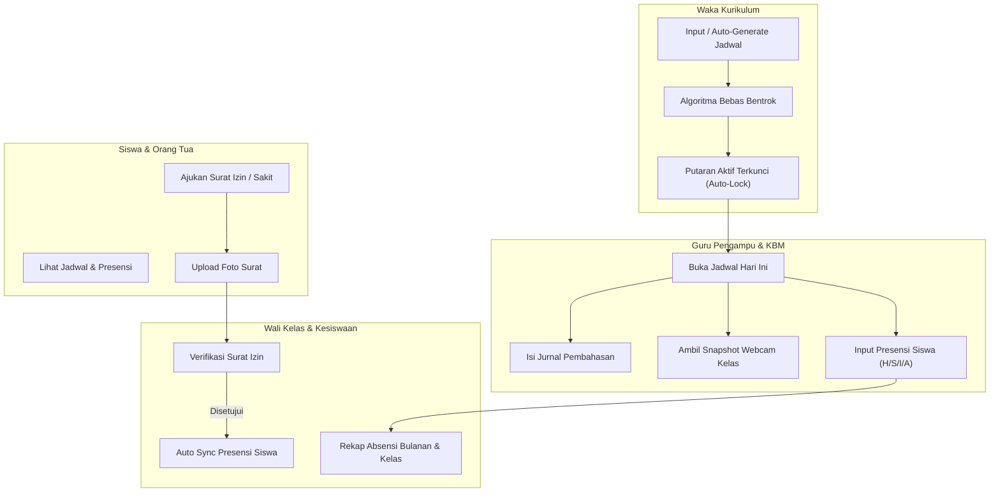

# 🏫 School Class Progress (SCP)
### *Sistem Informasi Sekolah Terpadu & Manajemen KBM Digital*

[](https://tugasukk.web.id)
[](https://www.php.net/)
[](https://laravel.com/)
[](https://tailwindcss.com/)
[](https://tidbcloud.com/)
[](https://github.com/muhyiyuddin87-creator/ukkmuhyiyuddin/actions)
[](https://semgrep.dev/)

---

## 📌 Tentang Proyek

**School Class Progress (SCP)** adalah platform komprehensif berbasis web yang dirancang khusus untuk memodernisasi dan mendigitalkan seluruh siklus **Kegiatan Belajar Mengajar (KBM)** dan tata kelola akademik di tingkat sekolah menengah kejuruan (SMK) / SMA.

Aplikasi ini mengatasi tantangan klasik manajemen sekolah seperti **tabrakan jadwal mengajar yang kompleks**, lambatnya rekapitulasi presensi manual, pencatatan jurnal mengajar yang tidak terdokumentasi dengan baik, serta birokrasi pengajuan surat izin sakit yang tercecer. Dengan arsitektur modern dan algoritma otomasi cerdas, SCP menyediakan transparansi real-time bagi pihak kurikulum, guru, wali kelas, kesiswaan, siswa, hingga wali murid.

> 🌐 **Akses Aplikasi Publik (Production):** [https://tugasukk.web.id](https://tugasukk.web.id)

---

## 🌟 Fitur Unggulan (Key Features)

### 1. ⚡ Generator Jadwal Cerdas Bebas Bentrok (1-Click Auto Scheduler)
* **Algoritma *Constraint-Satisfaction* Otomatis:** Memetakan ratusan alokasi mengajar guru, kelas, mata pelajaran, dan ruangan (teori maupun lab bengkel) ke slot hari Senin–Jumat secara otomatis tanpa ada jadwal ganda.
* **Heuristik Pemadatan Pagi (*Morning-Pack*):** Menjamin jam ke-1 tidak pernah kosong/bolong secara acak, serta menempelkan jam pelajaran secara berurutan agar efisien dan siswa tidak pulang-pergi di tengah hari.
* **Sistem Putaran Ganda (Putaran 1 & Putaran 2):** Mendukung pergantian siklus blok belajar mingguan/dwimingguan yang umum di SMK.
* **Auto-Lock Security:** Jadwal yang baru saja selesai di-*generate* otomatis langsung terkunci agar tidak teredit atau terhapus secara tidak sengaja.
* **Ekspor & Impor:** Cetak PDF jadwal resmi per kelas atau per guru, serta unduh dan unggah master data Excel format `.xlsx`/`.csv`.

### 2. 📖 Jurnal Mengajar Digital & Live Webcam Snapshot
* **Pencatatan Materi Harian:** Guru mengisi topik pembahasan, kompetensi dasar, serta catatan KBM langsung dari perangkat laptop maupun ponsel.
* **Dokumentasi Foto KBM (Webcam Capture):** Dilengkapi fitur ambil foto langsung dari webcam ruang kelas sebagai bukti autentik kehadiran fisik pengajar di kelas.
* **Peringatan Keterlambatan (*Late Journal Alert*):** Sistem otomatis mendeteksi jadwal KBM yang terlewat atau belum dilengkapi jurnal pada hari aktif.

### 3. 📋 Presensi Siswa Real-Time Terintegrasi
* **Pencatatan Kehadiran 4 Status:** Hadir, Sakit, Izin, dan Alpha yang terhubung langsung dengan jurnal jam pelajaran.
* **Monitoring Wali Kelas:** Wali kelas memiliki dasbor khusus untuk melihat rekapitulasi tingkat kehadiran siswa di kelas perwaliannya secara komprehensif.

### 4. ✉️ Disposisi & Pengajuan Izin Siswa Digital
* **Pengajuan Mandiri:** Siswa atau orang tua dapat mengajukan surat izin/sakit secara online disertai berkas lampiran (surat dokter/foto).
* **Verifikasi Bertingkat:** Notifikasi dan approval langsung di panel Wali Kelas dan Kesiswaan, yang otomatis memperbarui status presensi siswa pada jadwal terkait.

### 5. 👥 Tata Kelola Multi-Peran (Role-Based Access Control)
* **6 Tingkatan Akses Khusus:**
  1. **Waka Kurikulum:** Pemegang kendali penuh jadwal KBM, kunci putaran, kalender akademik, dan manajemen akun.
  2. **Guru Pengampu:** Akses jadwal mengajar, pengisian jurnal, dan presensi kelas harian.
  3. **Wali Kelas:** Rekapitulasi absensi perwalian, approval izin siswa kelasnya, dan reset password siswa.
  4. **Guru BK (Bimbingan Konseling):** Pendampingan dan pemantauan siswa kelas dampingan.
  5. **Kesiswaan:** Verifikasi ketertiban umum, rekapitulasi absensi tingkat sekolah, dan disposisi izin final.
  6. **Siswa & Orang Tua:** Pemantauan jadwal aktif, riwayat absensi, dan pengajuan izin digital.

---

## 🏛️ Arsitektur Alur Kerja Sistem



---

## 💻 Tech Stack & Kebutuhan Sistem

| Lapisan | Teknologi | Keterangan |
| :--- | :--- | :--- |
| **Backend** | PHP 8.3+, Laravel 12.x | Routing, MVC, Eloquent ORM, Session, Sanctum |
| **Frontend** | Blade Templates, Tailwind CSS 3.x, Alpine.js | Desain responsif modern & *glassmorphism* |
| **Database** | MySQL / TiDB Cloud Serverless | Distributed relational database dengan skalabilitas tinggi |
| **Office & PDF** | PhpSpreadsheet & DomPDF | Parser berkas `.xlsx`, `.csv`, dan generator dokumen `.pdf` |
| **CI/CD & Server** | GitHub Actions, Ubuntu 22.04 LTS, Nginx, PHP-FPM | Deployment otomatis tanpa *downtime* via SSH runner |
| **Keamanan** | Semgrep SAST, Bcrypt, Middleware RBAC | Proteksi akses rute backend & enkripsi kredensial |

---

## 🚀 Panduan Instalasi Lokal (Local Development)

Ikuti langkah-langkah di bawah ini untuk menjalankan proyek ini di komputer lokal (Windows / Linux / macOS):

### 1. Prasyarat Sistem
* PHP `>= 8.3` dengan ekstensi: `pdo_mysql`, `mbstring`, `openssl`, `xml`, `curl`, `zip`, `gd`.
* Composer `>= 2.x`
* Node.js `>= 18.x` & NPM
* Server MySQL / MariaDB (atau menggunakan Laragon / XAMPP)

### 2. Kloning Repository
```bash
git clone https://github.com/muhyiyuddin87-creator/ukkmuhyiyuddin.git
cd ukkmuhyiyuddin
```

### 3. Pasang Dependensi
```bash
# Dependensi PHP
composer install

# Dependensi Frontend (JavaScript & Tailwind)
npm install
```

### 4. Konfigurasi Environment (`.env`)
Salin file `.env.example` menjadi `.env`:
```bash
cp .env.example .env
```
Sesuaikan konfigurasi database pada `.env`:
```dotenv
APP_NAME="School Class Progress"
APP_ENV=local
APP_DEBUG=true
APP_URL=http://localhost:8000

DB_CONNECTION=mysql
DB_HOST=127.0.0.1
DB_PORT=3306
DB_DATABASE=db_tugasukk
DB_USERNAME=root
DB_PASSWORD=
```

### 5. Generate Application Key & Migrasi Database
```bash
php artisan key:generate
php artisan migrate --seed
```
*Perintah di atas akan membuat seluruh tabel yang dibutuhkan dan mengisi akun pengguna awal untuk pengujian.*

### 6. Build Aset Frontend & Jalankan Aplikasi
```bash
# Kompilasi frontend
npm run build

# Jalankan server pengembangan lokal
php artisan serve
```
Akses aplikasi melalui peramban di: `http://127.0.0.1:8000`

---

## 🔑 Akun Demo Pengujian (Default Test Accounts)

Untuk mempermudah peninjauan dan pengujian fitur oleh penguji/guru pembimbing, gunakan akun default berikut:

| Peran (Role) | Username | Password | Deskripsi Tugas & Akses |
| :--- | :--- | :--- | :--- |
| **Waka Kurikulum** | `waka` | `waka123` | Master jadwal, generator otomatis, kunci putaran, manajemen akun |
| **Guru Pengampu** | `guru` | `guru123` | Jadwal ajar mingguan, pengisian jurnal harian, dan presensi jam belajar |
| **Wali Kelas** | `rosyida.ramadhani.s.pd` | *Sesuai DB / waka reset* | Rekap absensi siswa perwalian (XII RPL 2), approval izin siswa |
| **Kesiswaan** | `kesiswaan` | `kesiswaan123` | Monitoring kedisiplinan dan persetujuan izin tingkat sekolah |
| **Siswa** | `siswa` *(atau `muhyiyuddin`)* | `siswa123` | Jadwal KBM siswa, riwayat absensi, dan pengajuan surat izin online |
| **Orang Tua** | `ortu` | `ortu123` | Memantau kehadiran dan status izin putra/putrinya dari rumah |

---

## 🛡️ Otomasi CI/CD & Deployment

Aplikasi ini telah terintegrasi penuh dengan **GitHub Actions** untuk implementasi *Continuous Integration & Continuous Deployment* (CI/CD):

1. **Security Audit (SAST Scan):** Setiap *push* ke branch `main` secara otomatis dipindai oleh **Semgrep Security Scanner** untuk mendeteksi potensi celah keamanan (XSS, SQL Injection, hardcoded secrets).
2. **Auto Deploy ke VPS (LEMP Stack):** Setelah lolos uji keamanan, SSH Runner melakukan deploy otomatis ke server VPS produksi:
   * Mengambil commit terbaru dari branch `main`.
   * Menjalankan migrasi database otomatis.
   * Melakukan optimasi cache Laravel (`config:cache`, `route:cache`, `view:cache`).
   * Melakukan *reload* layanan PHP-FPM dan Nginx secara aman tanpa memutus sesi pengguna aktif.

---

## 📂 Struktur Direktori Utama

```plaintext
├── app/
│   ├── Http/Controllers/       # Kontroller API dan Web
│   ├── Models/                 # Eloquent Model (User, Schedule, Siswa, Journal, dll.)
│   ├── Services/
│   │   └── AutoScheduleGeneratorService.php  # Engine cerdas penyusun jadwal KBM
│   └── Support/
│       ├── AcademicYear.php    # Resolver tahun ajaran dinamis
│       └── SchoolTimetable.php # Konfigurasi master sesi jam & slot hari belajar
├── database/
│   ├── migrations/             # Skema tabel database relasional
│   └── seeders/                # Data sampel akun, kelas, ruang, dan siswa
├── resources/
│   ├── views/
│   │   ├── waka/               # Modul Waka (Jadwal, Pengaturan, Akun)
│   │   ├── guru/               # Modul Guru (Isi Jurnal, Presensi, Jadwal)
│   │   ├── wali_kelas/         # Modul Wali Kelas (Izin, Rekap Siswa)
│   │   ├── kesiswaan/          # Modul Kesiswaan
│   │   ├── siswa/              # Modul Siswa & Pengajuan Izin
│   │   └── landing.blade.php   # Halaman beranda utama
├── routes/
│   └── web.php                 # Definisi rute aplikasi & proteksi hak akses
└── tests/
    └── Feature/                # Pengujian fungsionalitas otomatis (PHPUnit)
```

---

## 📄 Hak Cipta & Pengembang

Proyek ini dikembangkan sebagai karya **Uji Kompetensi Keahlian (UKK) Rekayasa Perangkat Lunak (RPL)** oleh **Muhyiyuddin** dengan standar industri web modern, keamanan data yang ketat, dan pengalaman pengguna (*UX*) yang elegan.

*Dilisensikan di bawah lisensi [MIT](LICENSE).*
