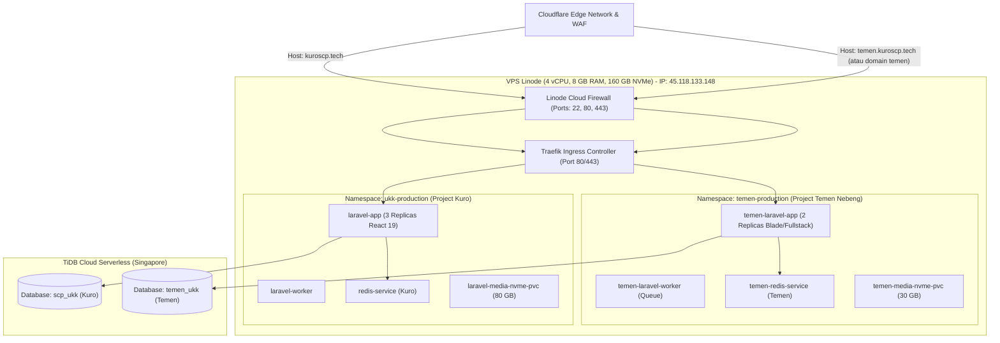

# 📘 Hands-on Runbook & SOP DevOps: Panduan Praktik Lapangan (Step-by-Step)
### *Implementasi Mandiri: K3s Kubernetes, TiDB Cloud, Local NVMe Media, Cloudflare CDN, DevSecOps & Multi-App Hosting ("Teman Nebeng")*

**Target Project Utama:** `School Class Progress UKK` (`scp-ukk`)  
**Target Project Kedua ("Teman Nebeng"):** `Fullstack Laravel (Blade / Livewire / Tailwind)`  
**Spesifikasi Server Target:** 1 VPS Linode Dedicated (4 vCPU, 8 GB RAM, 160 GB NVMe SSD, IP: `45.118.133.148`)  
**Domain Utama:** `kuroscp.tech`  
**Domain Teman:** `temen.kuroscp.tech` (atau domain kustom teman)

---

## 📋 LEMBAR KERJA PARAMETER (Isi Sebelum Mulai Eksekusi)

Sebelum mengetik perintah apa pun di terminal, pastikan parameter berikut tercatat dengan benar:

| Parameter Variabel | Nilai Riil Produksi | Keterangan |
| :--- | :--- | :--- |
| **IP Publik VPS** | `45.118.133.148` | Linode Singapore (SG) |
| **User SSH VPS** | `root` | Akses via Terminal / LISH |
| **Domain Utama Kuro** | `kuroscp.tech` | Cloudflare DNS Proxied (Orange Cloud) |
| **Domain Teman Nebeng** | `temen.kuroscp.tech` | Subdomain Cloudflare Kuro / Domain Teman |
| **Host TiDB Cloud** | `gateway01.ap-southeast-1.prod.aws.tidbcloud.com` | AWS Singapore |
| **Port TiDB Cloud** | `4000` | Port default MySQL SSL TiDB |
| **DB Name Kuro** | `scp_ukk` / `test` | Database Project Utama |
| **DB Name Teman** | `temen_ukk` | Database Terpisah untuk Teman |
| **Registry GitHub Kuro** | `ghcr.io/ryzenkuro/scp-ukk:latest` | Container Image Kuro (PHP 8.4) |
| **Registry GitHub Teman**| `ghcr.io/USER_TEMEN/app-temen:latest` | Container Image Teman Fullstack |

---

## 📑 DAFTAR MODUL PRAKTIK
- [MODUL 1: Setup Cloud Services (TiDB Cloud & Cloudflare) — SELESAI ✅](#modul-1-setup-cloud-services-tidb-cloud--cloudflare--status-done-)
- [MODUL 2: Hardening & Tuning VPS Ubuntu 24.04 — SELESAI ✅](#modul-2-hardening--tuning-vps-ubuntu-2404--status-done-)
- [MODUL 3: Penataan Project Laravel & Docker Multi-Stage Build — SELESAI ✅](#modul-3-penataan-project-laravel--docker-multi-stage-build--status-done-)
- [MODUL 4: Instalasi K3s Kubernetes & k9s TUI di VPS — SELESAI ✅](#modul-4-instalasi-k3s-kubernetes--k9s-tui-di-vps--status-done-)
- [MODUL 5: Eksekusi Deployment Kubernetes Manifests — SELESAI ✅](#modul-5-eksekusi-deployment-kubernetes-manifests--status-done-)
- [MODUL 6: Verifikasi Pasca-Deploy & Integrasi NVMe Media — SELESAI ✅](#modul-6-verifikasi-pasca-deploy--integrasi-nvme-media--status-done-)
- [MODUL 7: Setup DevSecOps Otomatis (GitHub Actions)](#modul-7-devsecops--eksekusi-manual-cli--pipeline-otomatis-github-actions)
- [MODUL 8: Pengujian Beban 1.000 Concurrent Users (k6 Load Test)](#modul-8-pengujian-beban-1000-concurrent-users-k6-load-test--lokasi-laptop-lokal--vps-penguji-lain-dilarang-di-vps-produksi)
- [MODUL 9: Runbook Troubleshooting & Emergency Recovery (SRE Guide)](#modul-9-runbook-troubleshooting--emergency-recovery-sre-guide--lokasi-terminal-vps-produksi-ssh)
- [MODUL 10: Multi-App Deployment — Panduan Menampung Project Teman ("Nebeng") Fullstack Laravel di K3s Cluster yang Sama](#modul-10-multi-app-deployment--panduan-menampung-project-teman-nebeng-fullstack-laravel-di-k3s-cluster-yang-sama)

---

## MODUL 1: Setup Cloud Services (TiDB Cloud & Cloudflare) — `[STATUS: DONE] ✅`

### Langkah 1.1: Pembuatan Cluster TiDB Cloud (Serverless) — `[STATUS: DONE] ✅` `🌐 [LOKASI: BROWSER CLOUD]`
1. Buka browser dan login ke [**TiDB Cloud Console**](https://tidbcloud.com/).
2. Buat Cluster Serverless di Region Singapore (`ap-southeast-1`).
3. Dapatkan Host, Port (4000), User (`4VKzw2H5oPCeXer.root`), dan Password.
4. Buat database:
   ```sql
   CREATE DATABASE scp_ukk;
   ```

### Langkah 1.2: Konfigurasi Domain & Cloudflare CDN — `[STATUS: DONE] ✅` `🌐 [LOKASI: BROWSER CLOUD]`
1. Domain `kuroscp.tech` diarahkan ke Cloudflare Name Servers.
2. Buat DNS Record:
   * Tipe: `A`, Name: `@`, IPv4: `45.118.133.148`, Proxy Status: **Proxied (Orange Cloud)**.
   * Tipe: `CNAME`, Name: `www`, Target: `kuroscp.tech`, Proxy: **Proxied**.
3. Masuk menu **SSL/TLS**:
   * Set SSL/TLS Encryption Mode: **`Full`** (atau **`Flexible`**).
4. Buat Cache Rules untuk aset statis `/storage/*` dan `/build/*` dengan edge TTL 1 tahun.

---

## MODUL 2: Hardening & Tuning VPS Ubuntu 24.04 — `[STATUS: DONE] ✅`

🖥️ `[LOKASI: TERMINAL VPS PRODUKSI (SSH)]`

### Langkah 2.1: Update & Install Core Packages
```bash
sudo apt update && sudo apt upgrade -y
sudo apt install -y curl wget git htop iotop net-tools ufw fail2ban unzip ca-certificates apt-transport-https
```

### Langkah 2.2: Setup Swap Space 4 GB (Safety Cushion)
```bash
sudo fallocate -l 4G /swapfile
sudo chmod 600 /swapfile
sudo mkswap /swapfile
sudo swapon /swapfile
echo '/swapfile none swap sw 0 0' | sudo tee -a /etc/fstab
```

### Langkah 2.3: Tuning Kernel Linux (/etc/sysctl.conf)
```bash
cat << 'EOF' | sudo tee -a /etc/sysctl.conf
vm.swappiness=10
net.core.somaxconn=65535
net.ipv4.tcp_max_syn_backlog=65535
fs.file-max=2097152
fs.inotify.max_user_watches=524288
fs.inotify.max_user_instances=8192
EOF
sudo sysctl -p
```

### Langkah 2.4: Keamanan Firewall (Linode Cloud Firewall vs UFW)
> [!IMPORTANT]
> **Best Practice SRE:** Di VPS Linode, gunakan **Linode Cloud Firewall (`webkuro-prod-fw`)** pada dashboard Linode (`cloud.linode.com/firewalls`) dan biarkan UFW lokal berstatus `inactive` agar tidak bentrok dengan `iptables` internal Kubernetes CNI Flannel.
> Buka Inbound Rules pada Linode Cloud Firewall:
> * `SSH` (Port 22, TCP, All IPv4/IPv6)
> * `HTTP` (Port 80, TCP, All IPv4/IPv6)
> * `HTTPS` (Port 443, TCP, All IPv4/IPv6)

---

## MODUL 3: Penataan Project Laravel & Docker Multi-Stage Build — `[STATUS: DONE] ✅`

💻 `[LOKASI: TERMINAL LAPTOP LOKAL (WSL / BASH)]`

### Langkah 3.1: Konfigurasi Dockerfile Produksi Modern (PHP 8.4 Alpine)
File `Dockerfile` di root project `scp-ukk`:
```dockerfile
# STAGE 1: Build Frontend Assets (React 19 + Vite)
FROM node:22-alpine AS frontend-builder
WORKDIR /app
COPY package.json package-lock.json ./
RUN npm ci --prefer-offline --no-audit
COPY resources ./resources
COPY vite.config.js tailwind.config.js postcss.config.js tsconfig.json ./
COPY public ./public
RUN npm run build

# STAGE 2: Build Backend Dependencies (Composer)
FROM composer:latest AS backend-builder
WORKDIR /app
COPY composer.json composer.lock ./
RUN composer install \
    --no-dev \
    --no-interaction \
    --prefer-dist \
    --optimize-autoloader \
    --no-scripts \
    --ignore-platform-reqs

# STAGE 3: Final Production Runtime (PHP 8.4-FPM Alpine)
FROM php:8.4-fpm-alpine
WORKDIR /var/www/html

RUN apk add --no-cache \
    nginx \
    supervisor \
    curl \
    ca-certificates \
    libpng-dev \
    libjpeg-turbo-dev \
    freetype-dev \
    libzip-dev \
    icu-dev \
    oniguruma-dev \
    tzdata \
    && update-ca-certificates

RUN docker-php-ext-configure gd --with-freetype --with-jpeg \
    && docker-php-ext-install -j$(nproc) \
        pdo_mysql mbstring exif pcntl bcmath gd zip intl opcache

RUN apk add --no-cache --virtual .build-deps $PHPIZE_DEPS \
    && pecl install redis \
    && docker-php-ext-enable redis \
    && apk del .build-deps

COPY docker/php/opcache.ini /usr/local/etc/php/conf.d/opcache.ini
COPY docker/php/custom.ini /usr/local/etc/php/conf.d/custom.ini
COPY docker/nginx/nginx.conf /etc/nginx/nginx.conf
COPY docker/supervisor/supervisord.conf /etc/supervisor/conf.d/supervisord.conf

COPY . /var/www/html
COPY --from=backend-builder /app/vendor /var/www/html/vendor
COPY --from=frontend-builder /app/public/build /var/www/html/public/build

RUN rm -f /var/www/html/bootstrap/cache/*.php \
    && mkdir -p /var/www/html/storage/app/public \
    && mkdir -p /var/www/html/storage/framework/cache \
    && mkdir -p /var/www/html/storage/framework/sessions \
    && mkdir -p /var/www/html/storage/framework/views \
    && mkdir -p /var/www/html/storage/logs \
    && chown -R www-data:www-data /var/www/html \
    && chmod -R 775 /var/www/html/storage /var/www/html/bootstrap/cache

EXPOSE 80
CMD ["/usr/bin/supervisord", "-c", "/etc/supervisor/conf.d/supervisord.conf"]
```

### Langkah 3.2: Konfigurasi Supervisor (`docker/supervisor/supervisord.conf`)
> [!IMPORTANT]
> Gunakan `command=php-fpm -F` (bukan `docker-php-fpm`).
```ini
[supervisord]
nodaemon=true
user=root
logfile=/var/log/supervisord.log
pidfile=/var/run/supervisord.pid

[program:php-fpm]
command=php-fpm -F
stdout_logfile=/dev/stdout
stdout_logfile_maxbytes=0
stderr_logfile=/dev/stderr
stderr_logfile_maxbytes=0
autorestart=true

[program:nginx]
command=/usr/sbin/nginx -g "daemon off;"
stdout_logfile=/dev/stdout
stdout_logfile_maxbytes=0
stderr_logfile=/dev/stderr
stderr_logfile_maxbytes=0
autorestart=true
```

### Langkah 3.3: Build & Push Image ke GHCR
```bash
# Login ke GHCR
echo "ghp_TOKEN_GITHUB_ANDA" | docker login ghcr.io -u ryzenkuro --password-stdin

# Build image
DOCKER_BUILDKIT=1 docker build -t ghcr.io/ryzenkuro/scp-ukk:latest .

# Push image
docker push ghcr.io/ryzenkuro/scp-ukk:latest
```

---

## MODUL 4: Instalasi K3s Kubernetes & k9s TUI di VPS — `[STATUS: DONE] ✅`

🖥️ `[LOKASI: TERMINAL VPS PRODUKSI]`

### Langkah 4.1: Instal K3s (Standard Mode)
```bash
curl -sfL https://get.k3s.io | sh -s - --write-kubeconfig-mode 644
```

### Langkah 4.2: Instal k9s CLI (Terminal UI Dashboard)
```bash
K9S_VERSION=$(curl -s https://api.github.com/repos/derailed/k9s/releases/latest | grep tag_name | cut -d '"' -f 4)
curl -sL https://github.com/derailed/k9s/releases/download/${K9S_VERSION}/k9s_Linux_amd64.tar.gz | tar -xz -C /usr/local/bin k9s
chmod +x /usr/local/bin/k9s
```

---

## MODUL 5: Eksekusi Deployment Kubernetes Manifests — `[STATUS: DONE] ✅`

🖥️ `[LOKASI: TERMINAL VPS PRODUKSI]`

Folder kerja di VPS: `/opt/k8s-ukk`

### 00-namespace.yaml
```yaml
apiVersion: v1
kind: Namespace
metadata:
  name: ukk-production
```

### 01-secrets-configmap.yaml
```yaml
apiVersion: v1
kind: ConfigMap
metadata:
  name: laravel-config
  namespace: ukk-production
data:
  APP_NAME: "School Class Progress UKK"
  APP_ENV: "production"
  APP_DEBUG: "false"
  APP_URL: "https://kuroscp.tech"
  LOG_CHANNEL: "stack"
  LOG_LEVEL: "error"
  DB_CONNECTION: "mysql"
  DB_HOST: "gateway01.ap-southeast-1.prod.aws.tidbcloud.com"
  DB_PORT: "4000"
  DB_DATABASE: "scp_ukk"
  MYSQL_ATTR_SSL_CA: "/etc/ssl/certs/ca-certificates.crt"
  SESSION_DRIVER: "redis"
  CACHE_STORE: "redis"
  QUEUE_CONNECTION: "redis"
  REDIS_HOST: "redis-service"
  REDIS_PORT: "6379"
---
apiVersion: v1
kind: Secret
metadata:
  name: laravel-secrets
  namespace: ukk-production
type: Opaque
stringData:
  APP_KEY: "base64:xMlhZ3BqRnp6SndYcW5QZEhV..."
  DB_USERNAME: "4VKzw2H5oPCeXer.root"
  DB_PASSWORD: "PasswordTiDBAnda"
```

### 02-storage-pvc.yaml
```yaml
apiVersion: v1
kind: PersistentVolumeClaim
metadata:
  name: laravel-media-nvme-pvc
  namespace: ukk-production
spec:
  accessModes:
  - ReadWriteOnce
  storageClassName: local-path
  resources:
    requests:
      storage: 80Gi
```

### 03-redis.yaml
```yaml
apiVersion: apps/v1
kind: Deployment
metadata:
  name: redis
  namespace: ukk-production
spec:
  replicas: 1
  selector:
    matchLabels:
      app: redis
  template:
    metadata:
      labels:
        app: redis
    spec:
      containers:
      - name: redis
        image: redis:7-alpine
        command: ["redis-server", "--maxmemory", "384mb", "--maxmemory-policy", "allkeys-lru"]
        ports:
        - containerPort: 6379
---
apiVersion: v1
kind: Service
metadata:
  name: redis-service
  namespace: ukk-production
spec:
  ports:
  - port: 6379
  selector:
    app: redis
```

### 04-laravel.yaml
```yaml
apiVersion: apps/v1
kind: Deployment
metadata:
  name: laravel-app
  namespace: ukk-production
spec:
  replicas: 3
  selector:
    matchLabels:
      app: laravel-app
  template:
    metadata:
      labels:
        app: laravel-app
    spec:
      initContainers:
      - name: laravel-init
        image: ghcr.io/ryzenkuro/scp-ukk:latest
        imagePullPolicy: Always
        command:
        - "sh"
        - "-c"
        - >
          php artisan config:cache &&
          php artisan route:cache &&
          php artisan view:cache &&
          php artisan storage:link &&
          php artisan migrate --force
        envFrom:
        - configMapRef:
            name: laravel-config
        - secretRef:
            name: laravel-secrets
        volumeMounts:
        - name: media-storage
          mountPath: /var/www/html/storage/app/public
      containers:
      - name: laravel-web
        image: ghcr.io/ryzenkuro/scp-ukk:latest
        imagePullPolicy: Always
        ports:
        - containerPort: 80
        envFrom:
        - configMapRef:
            name: laravel-config
        - secretRef:
            name: laravel-secrets
        volumeMounts:
        - name: media-storage
          mountPath: /var/www/html/storage/app/public
        resources:
          requests:
            memory: "256Mi"
            cpu: "200m"
          limits:
            memory: "768Mi"
            cpu: "1000m"
        readinessProbe:
          httpGet:
            path: /
            port: 80
          initialDelaySeconds: 10
          periodSeconds: 5
        livenessProbe:
          httpGet:
            path: /
            port: 80
          initialDelaySeconds: 20
          periodSeconds: 10
      volumes:
      - name: media-storage
        persistentVolumeClaim:
          claimName: laravel-media-nvme-pvc
---
apiVersion: apps/v1
kind: Deployment
metadata:
  name: laravel-worker
  namespace: ukk-production
spec:
  replicas: 1
  selector:
    matchLabels:
      app: laravel-worker
  template:
    metadata:
      labels:
        app: laravel-worker
    spec:
      containers:
      - name: worker
        image: ghcr.io/ryzenkuro/scp-ukk:latest
        imagePullPolicy: Always
        command: ["php", "artisan", "queue:work", "--tries=3", "--timeout=90", "--memory=256"]
        envFrom:
        - configMapRef:
            name: laravel-config
        - secretRef:
            name: laravel-secrets
        resources:
          requests:
            memory: "150Mi"
            cpu: "100m"
          limits:
            memory: "384Mi"
            cpu: "500m"
---
apiVersion: v1
kind: Service
metadata:
  name: laravel-service
  namespace: ukk-production
spec:
  ports:
  - port: 80
    targetPort: 80
  selector:
    app: laravel-app
```

### 05-ingress.yaml
```yaml
apiVersion: networking.k8s.io/v1
kind: Ingress
metadata:
  name: laravel-ingress
  namespace: ukk-production
  annotations:
    traefik.ingress.kubernetes.io/router.entrypoints: "web,websecure"
spec:
  ingressClassName: "traefik"
  rules:
  - host: kuroscp.tech
    http:
      paths:
      - path: /
        pathType: Prefix
        backend:
          service:
            name: laravel-service
            port:
              number: 80
```

---

## MODUL 6: Verifikasi Pasca-Deploy & Integrasi NVMe Media — `[STATUS: DONE] ✅`

🖥️ `[LOKASI: TERMINAL VPS PRODUKSI & BROWSER]`

### Langkah 6.1: Cek Status Pod (Semua 1/1 Running)
```bash
kubectl get pods -n ukk-production -o wide
```
*Hasil:* 3 Pod `laravel-app`, 1 Pod `laravel-worker`, dan 1 Pod `redis` berstatus `1/1 Running` (Restarts 0).

### Langkah 6.2: Verifikasi Koneksi Database TiDB & Seeding Data
```bash
LARAVEL_POD=$(kubectl get pods -n ukk-production -l app=laravel-app -o jsonpath="{.items[0].metadata.name}")

# Cek monitor koneksi database
kubectl exec -it -n ukk-production $LARAVEL_POD -- php artisan db:monitor

# Eksekusi database seeder untuk membuat akun waka, guru, siswa
kubectl exec -it -n ukk-production $LARAVEL_POD -- php artisan db:seed --force
```

### Langkah 6.3: Uji Coba Symlink Media NVMe Storage
```bash
# Buat file percobaan
kubectl exec -it -n ukk-production $LARAVEL_POD -- sh -c "echo 'Media Storage Berhasil' > /var/www/html/storage/app/public/test.txt"

# Pastikan file terbaca di public/storage
kubectl exec -it -n ukk-production $LARAVEL_POD -- ls -la /var/www/html/public/storage
```

### Langkah 6.4: Smoke Test Akses Website Publik
Akses melalui browser:  
👉 **`https://kuroscp.tech/login`**  
Credential: `username: waka`, `password: password`.

---

## MODUL 7: DevSecOps — Eksekusi Manual CLI & Pipeline Otomatis GitHub Actions

### 1. Semgrep SAST Scan (Analisis Kode Statis & Celah Keamanan)
```bash
semgrep scan --config auto --error
```
### 2. Trivy Container Vulnerability Scan
```bash
trivy image --severity HIGH,CRITICAL ghcr.io/ryzenkuro/scp-ukk:latest
```
### 3. Nuclei DAST Scan (Pemeriksaan Kerentanan Web Aktif)
```bash
nuclei -u https://kuroscp.tech -severity critical,high -silent
```
### 4. OWASP ZAP Baseline Security Scan
```bash
docker run --rm -v $(pwd):/zap/wrk/:rw zaproxy/zap-stable zap-baseline.py -t https://kuroscp.tech -r zap_report.html
```
### 5. Strix AI Agentic Pentest (Automated Pen Testing)
```bash
strix -n --target "https://kuroscp.tech" --scan-mode quick
```

---

## MODUL 8: Pengujian Beban 1.000 Concurrent Users (k6 Load Test) — 🧪 `[LOKASI: LAPTOP LOKAL / VPS PENGUJI LAIN (DILARANG DI VPS PRODUKSI)]`

Buat file `load-test.js`:
```javascript
import http from 'k6/http';
import { check, sleep } from 'k6';

export const options = {
  stages: [
    { duration: '1m', target: 200 },   // Menanjak ke 200 user
    { duration: '2m', target: 500 },   // Stabil di 500 user
    { duration: '2m', target: 1000 },  // Puncak stress test 1.000 user
    { duration: '1m', target: 0 },     // Ramp-down pendinginan
  ],
  thresholds: {
    http_req_duration: ['p(95)<500'],  // 95% request harus di bawah 500ms
    http_req_failed: ['rate<0.01'],    // Tingkat error harus di bawah 1%
  },
};

export default function () {
  const res = http.get('https://kuroscp.tech/');
  check(res, {
    'status is 200 or 302': (r) => r.status === 200 || r.status === 302,
  });
  sleep(1);
}
```

Jalankan pengujian dari laptop Anda:
```bash
k6 run load-test.js
```

---

## MODUL 9: Runbook Troubleshooting & Emergency Recovery (SRE Guide)

| Gejala Error | Akar Masalah | Solusi Teruji |
| :--- | :--- | :--- |
| **`In Request.php line 117: syntax error "{"`** | Library Symfony 8 / Laravel 13 menggunakan Property Hooks PHP 8.4, sedangkan runtime masih PHP 8.3 | Ganti base Dockerfile ke `php:8.4-fpm-alpine`, rebuild, dan push image. |
| **`Class "Laravel\Pail\..." not found`** | File dev cache `bootstrap/cache/packages.php` dari laptop ter-copy ke image production | Tambahkan `bootstrap/cache/*.php` ke `.dockerignore` dan beri perintah `rm -f /var/www/html/bootstrap/cache/*.php` di Dockerfile. |
| **`spawnerr: can't find command 'docker-php-fpm'` / Probe 502** | Binary PHP-FPM di Alpine Linux bernama `php-fpm` | Ubah di `docker/supervisor/supervisord.conf`: `command=php-fpm -F`. |
| **Cloudflare Error 522 (Connection Timed Out)** | ServiceLB K3s tidak aktif (`--disable servicelb`) atau firewall UFW/Linode memblokir port 80/443 | 1. Hapus `--disable servicelb` dengan menjalankan `curl -sfL https://get.k3s.io \| sh -s - --write-kubeconfig-mode 644`.<br>2. Buka port 80 & 443 pada Linode Cloud Firewall (`webkuro-prod-fw`).<br>3. Nonaktifkan UFW lokal (`sudo ufw disable`). |
| **Cloudflare Error 526 (Invalid SSL Certificate)** | Cloudflare SSL mode disetel ke *Full (strict)* sementara Traefik menggunakan default cert | Di Cloudflare Dashboard ➔ Menu **SSL/TLS** ➔ Ubah mode dari **Full (strict)** ke **Full** (atau **Flexible**). |

---

---

# 🚀 MODUL 10: Multi-App Deployment — Panduan Menampung Project Teman ("Nebeng") Fullstack Laravel di K3s Cluster yang Sama

Modul ini adalah panduan lengkap cara menampung **Project Teman yang bertipe Fullstack Laravel Murni (Blade / Livewire / Breeze / Tailwind)** di dalam VPS Linode & Cluster K3s Kuro yang sudah berjalan, **tanpa mengganggu atau memutus project Kuro yang sudah live**.

---

### 10.1: Arsitektur Multi-Tenancy K3s (Prinsip Zero-Conflict)

Di dalam Kubernetes K3s, satu VPS tunggal berkapasitas 8 GB RAM mampu menampung 5-10 website berbeda secara bersamaan dengan membagi ruang isolasi:



#### 🛡️ 4 Pilar Pemisah (Agar Project Teman Tidak Bentrok dengan Kuro):
1. **Namespace Terpisah (`temen-production`):**  
   Semua pod, secret, config, service teman berada di dalam namespace baru. Tidak akan ada bentrok nama aplikasi atau environment.
2. **Database Terpisah (`temen_ukk`):**  
   Dibuatkan database tersendiri di TiDB Cloud. Tabel-tabel teman tidak akan mencemari tabel Kuro.
3. **Penyimpanan NVMe Terpisah (`temen-media-nvme-pvc`):**  
   Disediakan kuota PVC sendiri (misal 30 GB) agar file upload teman tidak memakan jatah media Kuro.
4. **Host-Based Ingress Routing Traefik:**  
   Traefik membedakan pengunjung dari nama domain.  
   - Pengunjung `kuroscp.tech` ➡️ dialirkan ke `laravel-app` Kuro.  
   - Pengunjung `temen.kuroscp.tech` (atau domain custom teman) ➡️ dialirkan ke `temen-laravel-app`.

---

### 10.2: Persiapan di Sisi Laptop Teman (Dockerizing Fullstack Laravel)

💻 `[LOKASI: TERMINAL LAPTOP TEMAN]`

Project teman adalah **Fullstack Laravel Murni** (Laravel MVC + Blade views + Tailwind / Vite). Berbeda dengan project Kuro yang memiliki frontend React terpisah, project fullstack Laravel lebih ramping.

#### Langkah 10.2.1: Buat File `.dockerignore` di Project Teman
Di folder root project Laravel teman:
```text
.git
.github
node_modules
vendor
bootstrap/cache/*.php
storage/framework/cache/data/*
storage/framework/sessions/*
storage/framework/views/*
storage/logs/*
tests
.env
.phpunit.result.cache
npm-debug.log
```

#### Langkah 10.2.2: Buat File `Dockerfile` Khusus Fullstack Laravel
Simpan di root project teman:
```dockerfile
# ==========================================
# STAGE 1: Build Assets (Blade / Tailwind / Vite)
# ==========================================
FROM node:22-alpine AS asset-builder
WORKDIR /app
COPY package.json package-lock.json ./
RUN npm ci --prefer-offline --no-audit
COPY resources ./resources
COPY vite.config.js tailwind.config.js postcss.config.js ./
COPY public ./public
RUN npm run build

# ==========================================
# STAGE 2: Build PHP Backend Dependencies
# ==========================================
FROM composer:latest AS vendor-builder
WORKDIR /app
COPY composer.json composer.lock ./
RUN composer install \
    --no-dev \
    --no-interaction \
    --prefer-dist \
    --optimize-autoloader \
    --no-scripts \
    --ignore-platform-reqs

# ==========================================
# STAGE 3: Production Runtime (PHP 8.4 Alpine + Nginx)
# ==========================================
FROM php:8.4-fpm-alpine
WORKDIR /var/www/html

# Install dependensi sistem & modul PHP
RUN apk add --no-cache \
    nginx \
    supervisor \
    curl \
    ca-certificates \
    libpng-dev \
    libjpeg-turbo-dev \
    freetype-dev \
    libzip-dev \
    icu-dev \
    oniguruma-dev \
    tzdata \
    && update-ca-certificates

RUN docker-php-ext-configure gd --with-freetype --with-jpeg \
    && docker-php-ext-install -j$(nproc) \
        pdo_mysql mbstring exif pcntl bcmath gd zip intl opcache

# Install ekstensi phpredis
RUN apk add --no-cache --virtual .build-deps $PHPIZE_DEPS \
    && pecl install redis \
    && docker-php-ext-enable redis \
    && apk del .build-deps

# Copy konfigurasi web & process manager
COPY docker/nginx/nginx.conf /etc/nginx/nginx.conf
COPY docker/supervisor/supervisord.conf /etc/supervisor/conf.d/supervisord.conf

# Copy source code aplikasi teman
COPY . /var/www/html
COPY --from=vendor-builder /app/vendor /var/www/html/vendor
COPY --from=asset-builder /app/public/build /var/www/html/public/build

# Bersihkan cache lama & set izin akses
RUN rm -f /var/www/html/bootstrap/cache/*.php \
    && mkdir -p /var/www/html/storage/app/public \
    && mkdir -p /var/www/html/storage/framework/cache \
    && mkdir -p /var/www/html/storage/framework/sessions \
    && mkdir -p /var/www/html/storage/framework/views \
    && mkdir -p /var/www/html/storage/logs \
    && chown -R www-data:www-data /var/www/html \
    && chmod -R 775 /var/www/html/storage /var/www/html/bootstrap/cache

EXPOSE 80
CMD ["/usr/bin/supervisord", "-c", "/etc/supervisor/conf.d/supervisord.conf"]
```

#### Langkah 10.2.3: Konfigurasi Nginx Teman (`docker/nginx/nginx.conf`)
Buat file `docker/nginx/nginx.conf` di project teman:
```nginx
worker_processes auto;
pid /var/run/nginx.pid;

events {
    worker_connections 2048;
    multi_accept on;
}

http {
    include /etc/nginx/mime.types;
    default_type application/octet-stream;
    sendfile on;
    tcp_nopush on;
    tcp_nodelay on;
    keepalive_timeout 65;
    server_tokens off;

    gzip on;
    gzip_vary on;
    gzip_types text/plain text/css application/json application/javascript image/svg+xml;

    server {
        listen 80;
        server_name _;
        root /var/www/html/public;
        index index.php index.html;

        client_max_body_size 50M;

        location / {
            try_files $uri $uri/ /index.php?$query_string;
        }

        location ~* ^/storage/ {
            expires 1y;
            access_log off;
            add_header Cache-Control "public, max-age=31536000, immutable";
            try_files $uri =404;
        }

        location ~* \.(?:css|js|jpg|jpeg|gif|png|ico|svg|woff2|woff)$ {
            expires 1y;
            access_log off;
            add_header Cache-Control "public, max-age=31536000, immutable";
        }

        location ~ \.php$ {
            fastcgi_split_path_info ^(.+\.php)(/.+)$;
            fastcgi_pass 127.0.0.1:9000;
            fastcgi_index index.php;
            include fastcgi_params;
            fastcgi_param SCRIPT_FILENAME $document_root$fastcgi_script_name;
            fastcgi_buffers 16 16k;
            fastcgi_buffer_size 32k;
            fastcgi_read_timeout 60s;
        }

        location ~ /\.(?!well-known).* {
            deny all;
        }
    }
}
```

#### Langkah 10.2.4: Konfigurasi Supervisor Teman (`docker/supervisor/supervisord.conf`)
Buat file `docker/supervisor/supervisord.conf` di project teman:
```ini
[supervisord]
nodaemon=true
user=root
logfile=/var/log/supervisord.log
pidfile=/var/run/supervisord.pid

[program:php-fpm]
command=php-fpm -F
stdout_logfile=/dev/stdout
stdout_logfile_maxbytes=0
stderr_logfile=/dev/stderr
stderr_logfile_maxbytes=0
autorestart=true

[program:nginx]
command=/usr/sbin/nginx -g "daemon off;"
stdout_logfile=/dev/stdout
stdout_logfile_maxbytes=0
stderr_logfile=/dev/stderr
stderr_logfile_maxbytes=0
autorestart=true
```

#### Langkah 10.2.5: Teman Melakukan Build & Push ke GitHub Container Registry
Minta teman Anda menjalankan perintah ini di terminal laptopnya:
```bash
# 1. Login ke GHCR milik teman
echo "ghp_TOKEN_GITHUB_TEMAN" | docker login ghcr.io -u USERNAME_TEMAN --password-stdin

# 2. Build image
DOCKER_BUILDKIT=1 docker build -t ghcr.io/USERNAME_TEMAN/project-temen:latest .

# 3. Push image ke GitHub
docker push ghcr.io/USERNAME_TEMAN/project-temen:latest
```
> [!IMPORTANT]
> Pastikan di GitHub teman Anda:  
> Masuk ke profile GitHub teman ➔ Tab **Packages** ➔ Klik paket `project-temen` ➔ **Package settings** ➔ Ubah visibility menjadi **Public** agar K3s di VPS Kuro bisa mendownload image tersebut tanpa kendala login.

---

### 10.3: Setup Database & Domain untuk Teman

#### Langkah 10.3.1: Buat Database Baru di TiDB Cloud 🌐 `[LOKASI: BROWSER CLOUD]`
1. Buka [**TiDB Cloud Console**](https://tidbcloud.com/).
2. Masuk ke cluster Anda (`ukk-cluster`) ➔ Klik menu **SQL Editor**.
3. Jalankan query SQL ini untuk membuat database khusus teman:
   ```sql
   CREATE DATABASE temen_ukk;
   ```
*(Dengan ini, data teman tersimpan rapi dan terisolasi dari database `scp_ukk` milik Kuro)*.

---

#### Langkah 10.3.2: Setting Domain / DNS di Cloudflare 🌐 `[LOKASI: BROWSER CLOUD]`
Pilih salah satu dari 2 opsi domain:

* **Opsi A (Subdomain Gratis dari Kuro — Direkomendasikan):**
  1. Buka dashboard Cloudflare Kuro (`kuroscp.tech`).
  2. Masuk ke menu **DNS** ➔ **Records**.
  3. Tambahkan Record baru:
     * **Type:** `A`
     * **Name:** `temen` (menghasilkan domain `temen.kuroscp.tech`)
     * **IPv4 address:** `45.118.133.148` (IP VPS Linode yang sama)
     * **Proxy status:** **Proxied (Orange Cloud)**
     * Klik **Save**.

* **Opsi B (Menggunakan Domain Teman Sendiri, misal: `temenproject.my.id`):**
  1. Teman memasukkan domainnya ke Cloudflare miliknya sendiri.
  2. Teman membuat DNS Record `A` yang mengarah ke IP VPS Kuro:
     * **Name:** `@` (atau subdomain)
     * **IPv4 address:** `45.118.133.148`
     * **Proxy status:** **Proxied**
  3. Set SSL/TLS di Cloudflare teman menjadi **Full**.

---

### 10.4: Pembuatan Manifest Kubernetes untuk Teman di VPS

🖥️ `[LOKASI: TERMINAL VPS PRODUKSI (SSH)]`

Masuk ke terminal VPS Kuro dan buat folder konfigurasi khusus teman:
```bash
mkdir -p /opt/k8s-temen
cd /opt/k8s-temen
```

#### 1. `00-namespace.yaml`
```bash
cat << 'EOF' > 00-namespace.yaml
apiVersion: v1
kind: Namespace
metadata:
  name: temen-production
EOF

kubectl apply -f 00-namespace.yaml
```

---

#### 2. `01-secrets-configmap.yaml`
> [!TIP]
> Dapatkan `APP_KEY` milik teman dengan menjalankan `php artisan key:generate --show` di laptop teman.
```bash
cat << 'EOF' > 01-secrets-configmap.yaml
apiVersion: v1
kind: ConfigMap
metadata:
  name: temen-laravel-config
  namespace: temen-production
data:
  APP_NAME: "Project Teman UKK"
  APP_ENV: "production"
  APP_DEBUG: "false"
  APP_URL: "https://temen.kuroscp.tech" # Ganti jika teman pakai domain sendiri
  LOG_CHANNEL: "stack"
  LOG_LEVEL: "error"
  DB_CONNECTION: "mysql"
  DB_HOST: "gateway01.ap-southeast-1.prod.aws.tidbcloud.com"
  DB_PORT: "4000"
  DB_DATABASE: "temen_ukk"
  MYSQL_ATTR_SSL_CA: "/etc/ssl/certs/ca-certificates.crt"
  SESSION_DRIVER: "redis"
  CACHE_STORE: "redis"
  QUEUE_CONNECTION: "redis"
  REDIS_HOST: "temen-redis-service"
  REDIS_PORT: "6379"
---
apiVersion: v1
kind: Secret
metadata:
  name: temen-laravel-secrets
  namespace: temen-production
type: Opaque
stringData:
  APP_KEY: "base64:GANTI_DENGAN_APP_KEY_MILIK_TEMAN="
  DB_USERNAME: "4VKzw2H5oPCeXer.root"
  DB_PASSWORD: "PasswordKuatTiDB123!"
EOF

kubectl apply -f 01-secrets-configmap.yaml
```

---

#### 3. `02-storage-pvc.yaml` (Penyimpanan NVMe Teman)
Kita alokasikan jatah penyimpanan media teman sebesar **30 GB** (dari sisa 80 GB NVMe VPS Anda):
```bash
cat << 'EOF' > 02-storage-pvc.yaml
apiVersion: v1
kind: PersistentVolumeClaim
metadata:
  name: temen-media-nvme-pvc
  namespace: temen-production
spec:
  accessModes:
  - ReadWriteOnce
  storageClassName: local-path
  resources:
    requests:
      storage: 30Gi
EOF

kubectl apply -f 02-storage-pvc.yaml
```

---

#### 4. `03-redis.yaml` (Cache & Queue Teman)
Redis terisolasi agar antrean job teman tidak tercampur dengan antrean Kuro:
```bash
cat << 'EOF' > 03-redis.yaml
apiVersion: apps/v1
kind: Deployment
metadata:
  name: temen-redis
  namespace: temen-production
spec:
  replicas: 1
  selector:
    matchLabels:
      app: temen-redis
  template:
    metadata:
      labels:
        app: temen-redis
    spec:
      containers:
      - name: redis
        image: redis:7-alpine
        command: ["redis-server", "--maxmemory", "192mb", "--maxmemory-policy", "allkeys-lru"]
        ports:
        - containerPort: 6379
        resources:
          limits:
            memory: "256Mi"
            cpu: "200m"
---
apiVersion: v1
kind: Service
metadata:
  name: temen-redis-service
  namespace: temen-production
spec:
  ports:
  - port: 6379
  selector:
    app: temen-redis
EOF

kubectl apply -f 03-redis.yaml
```

---

#### 5. `04-laravel.yaml` (Deployment App & Worker Teman)
> [!NOTE]
> Ganti `ghcr.io/USERNAME_TEMAN/project-temen:latest` dengan nama image milik teman Anda.  
> Alokasi replika untuk teman disetel ke **2 replika** dengan Resource Limits ketat agar server Kuro tetap stabil.
```bash
cat << 'EOF' > 04-laravel.yaml
apiVersion: apps/v1
kind: Deployment
metadata:
  name: temen-laravel-app
  namespace: temen-production
spec:
  replicas: 2
  selector:
    matchLabels:
      app: temen-laravel-app
  template:
    metadata:
      labels:
        app: temen-laravel-app
    spec:
      initContainers:
      - name: laravel-init
        image: ghcr.io/USERNAME_TEMAN/project-temen:latest
        imagePullPolicy: Always
        command:
        - "sh"
        - "-c"
        - >
          php artisan config:cache &&
          php artisan route:cache &&
          php artisan view:cache &&
          php artisan storage:link &&
          php artisan migrate --force
        envFrom:
        - configMapRef:
            name: temen-laravel-config
        - secretRef:
            name: temen-laravel-secrets
        volumeMounts:
        - name: media-storage
          mountPath: /var/www/html/storage/app/public
      containers:
      - name: laravel-web
        image: ghcr.io/USERNAME_TEMAN/project-temen:latest
        imagePullPolicy: Always
        ports:
        - containerPort: 80
        envFrom:
        - configMapRef:
            name: temen-laravel-config
        - secretRef:
            name: temen-laravel-secrets
        volumeMounts:
        - name: media-storage
          mountPath: /var/www/html/storage/app/public
        resources:
          requests:
            memory: "200Mi"
            cpu: "150m"
          limits:
            memory: "512Mi"
            cpu: "750m"
        readinessProbe:
          httpGet:
            path: /
            port: 80
          initialDelaySeconds: 10
          periodSeconds: 5
        livenessProbe:
          httpGet:
            path: /
            port: 80
          initialDelaySeconds: 20
          periodSeconds: 10
      volumes:
      - name: media-storage
        persistentVolumeClaim:
          claimName: temen-media-nvme-pvc
---
apiVersion: apps/v1
kind: Deployment
metadata:
  name: temen-laravel-worker
  namespace: temen-production
spec:
  replicas: 1
  selector:
    matchLabels:
      app: temen-laravel-worker
  template:
    metadata:
      labels:
        app: temen-laravel-worker
    spec:
      containers:
      - name: worker
        image: ghcr.io/USERNAME_TEMAN/project-temen:latest
        imagePullPolicy: Always
        command: ["php", "artisan", "queue:work", "--tries=3", "--timeout=90", "--memory=192"]
        envFrom:
        - configMapRef:
            name: temen-laravel-config
        - secretRef:
            name: temen-laravel-secrets
        resources:
          requests:
            memory: "100Mi"
            cpu: "100m"
          limits:
            memory: "256Mi"
            cpu: "300m"
---
apiVersion: v1
kind: Service
metadata:
  name: temen-laravel-service
  namespace: temen-production
spec:
  ports:
  - port: 80
    targetPort: 80
  selector:
    app: temen-laravel-app
EOF

kubectl apply -f 04-laravel.yaml
```

---

#### 6. `05-ingress.yaml` (Routing Domain Teman via Traefik)
Inilah kunci utama Traefik: Traefik secara cerdas membaca domain `temen.kuroscp.tech` dan mengalirkannya ke `temen-laravel-service`!
```bash
cat << 'EOF' > 05-ingress.yaml
apiVersion: networking.k8s.io/v1
kind: Ingress
metadata:
  name: temen-laravel-ingress
  namespace: temen-production
  annotations:
    traefik.ingress.kubernetes.io/router.entrypoints: "web,websecure"
spec:
  ingressClassName: "traefik"
  rules:
  - host: temen.kuroscp.tech  # Jika teman memakai domain sendiri, masukkan domain teman di sini
    http:
      paths:
      - path: /
        pathType: Prefix
        backend:
          service:
            name: temen-laravel-service
            port:
              number: 80
EOF

kubectl apply -f 05-ingress.yaml
```

---

### 10.5: Eksekusi & Verifikasi Aplikasi Teman

🖥️ `[LOKASI: TERMINAL VPS PRODUKSI]`

#### 1. Pantau Status Pod Teman
```bash
kubectl get pods -n temen-production -w
```
*Tunggu hingga semua pod teman berstatus `1/1 Running`:*
* `temen-laravel-app-...` (2/2 Running)
* `temen-laravel-worker-...` (1/1 Running)
* `temen-redis-...` (1/1 Running)

#### 2. Jalankan Seeder Database Teman (Jika Ada Akun Awal)
```bash
TEMEN_POD=$(kubectl get pods -n temen-production -l app=temen-laravel-app -o jsonpath="{.items[0].metadata.name}")

# Tes koneksi database teman
kubectl exec -it -n temen-production $TEMEN_POD -- php artisan db:monitor

# Jalankan seeder teman
kubectl exec -it -n temen-production $TEMEN_POD -- php artisan db:seed --force
```

#### 3. Cek Berdampingan via k9s TUI
Ketik perintah ini di VPS untuk memantau kedua project sekaligus secara visual:
```bash
k9s
```
* Tekan tombol `:namespace` ➔ Pilih **`0`** (All Namespaces).
* Anda akan melihat pod Kuro (`ukk-production`) dan pod Teman (`temen-production`) hidup berdampingan secara harmonis tanpa bentrok!

#### 4. Uji Akses Browser
Buka di browser:
👉 **`https://temen.kuroscp.tech`** (atau domain kustom teman).  
Website Fullstack Laravel teman sekarang sudah resmi live bersama website Anda di cloud! 🎉

---

### 10.6: Guardrails Keamanan Kuro (Batas RAM & CPU)

Sebagai "pemilik VPS", Kuro memiliki kontrol mutlak terhadap resource agar aplikasi teman tidak bisa memonopoli CPU/RAM VPS:

| Komponen | Alokasi Kuro (`ukk-production`) | Alokasi Teman (`temen-production`) | Sisa Resource Bebas VPS |
| :--- | :--- | :--- | :--- |
| **Replikasi Web Pod** | 3 Replicas | 2 Replicas | Fleksibel |
| **RAM Limits Maksimal** | 3 x 768MB + 384MB = **~2.7 GB** | 2 x 512MB + 256MB = **~1.2 GB** | **~4.1 GB Bebas** (Sangat Longgar) |
| **CPU Limits Maksimal** | 3.5 Core | 1.8 Core | **Shared Burst via K3s** |
| **Storage NVMe** | 80 GB | 30 GB | **50 GB Bebas** |

Dengan pembatasan `resources.limits` yang sudah kita pasang di manifest teman, jika website teman tiba-tiba mengalami lonjakan traffic gila-gilaan, Kubernetes akan menahan konsumsi RAM teman di batas maksimal 512MB per pod, sehingga **website Kuro di `kuroscp.tech` tetap 100% aman, stabil, dan tidak akan pernah terkena lag/down!**
